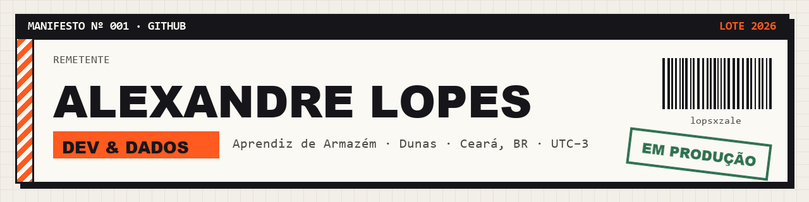

<a href="https://lopsxzale.github.io/">
  <picture>
    <source media="(prefers-color-scheme: dark)" srcset="assets/banner-dark.png" />
    
  </picture>
</a>

  <a href="https://lopsxzale.github.io/"><b>Portfólio</b></a> ·
  <a href="https://www.linkedin.com/in/alexandrelopes0/">LinkedIn</a> ·
  <a href="mailto:alefilhoyt@gmail.com">E-mail</a> ·
  <a href="https://lopsxzale.github.io/?foco=dados">Portfólio · foco Dados</a> ·
  <a href="https://lopsxzale.github.io/?foco=dev">Portfólio · foco Dev</a>

Ciência da Computação no **IFCE** (5º período) e Aprendiz de Armazém na **Dunas · Revenda Ambev**.
Criei e mantenho o **Sinc**, um SaaS de agendamento e gestão para barbearias em produção, e uso **SQL** e **Python** para responder perguntas reais com dados: do pipeline ao achado, e do achado à recomendação.

## Lotes expedidos

| Lote | Projeto | Pergunta → resultado | Links |
|:---:|---|---|---|
| **001** | **Sinc** Next.js · TypeScript · PostgreSQL · Supabase | SaaS multi-tenant em produção desde 10/2026, usado por barbearias reais. Regras no banco: 42 migrations, RLS nas 17 tabelas, mais de 80 funções SQL e uma restrição que impede dois agendamentos no mesmo horário. | [no ar](https://sincbarber.com.br) |
| **002** | **Combustível & Logística** Python · pandas · SQL · PostgreSQL · pytest · CI | *Quanto custa abastecer uma operação de distribuição, onde e com que risco?* 2,6 mi preços da ANP (2023–2025): o Norte paga R$ 6,40/L, **7,4% acima** do resto do país. Pipeline idempotente, 32 testes e simulador de custo de frota. | [no ar](https://combustivel-logistica.vercel.app/pt/) · [código](https://github.com/lopsxzale/logistics-distribution-analytics) |
| **003** | **E-commerce Sales Analytics** SQL · PostgreSQL · Python · SciPy · Docker | *O que 100 mil pedidos revelam sobre o e-commerce brasileiro?* Atrasar a entrega derruba a nota de **4,29 para 2,27** (Mann-Whitney, IC 95%). Window functions, segmentação RFM e site bilíngue com Lighthouse 100. | [no ar](https://vendas-e-commercebr.vercel.app/pt/) · [código](https://github.com/lopsxzale/ecommerce-sales-analytics) |

Baú de estudos: [Fundamentos](https://github.com/lopsxzale/Fundamentos) — TAD lista genérica em C com ponteiros opacos e callbacks, e daemons de automação em Python.

## Estoque

**Dados** &nbsp;

**Dev** &nbsp;

**Qualidade** &nbsp;

## Agora

Evoluindo o Sinc e fazendo análises de dados em SQL e Python.

<b>In English</b>

 

Computer Science student at **IFCE** (5th semester) and Warehouse Apprentice at **Dunas · Ambev Distributor**, based in Ceará, Brazil (UTC−3).
I built and maintain **Sinc**, a booking and management SaaS for barbershops in production, and I use **SQL** and **Python** to answer real questions with data.

- **Sinc** — multi-tenant SaaS in production: PostgreSQL with row-level security on every table, 80+ SQL functions and a constraint that makes double bookings impossible. [Live](https://sincbarber.com.br)
- **Fuel & Logistics** — 2.6M fuel prices from Brazil's regulator: the North pays 7.4% more for diesel than the rest of the country. Tested pipeline and fleet cost simulator. [Live](https://combustivel-logistica.vercel.app/en/) · [Code](https://github.com/lopsxzale/logistics-distribution-analytics)
- **E-commerce Sales Analytics** — 100k orders: a late delivery drops the review score from 4.29 to 2.27. Analytical SQL, statistical testing and RFM segmentation. [Live](https://vendas-e-commercebr.vercel.app/en/) · [Code](https://github.com/lopsxzale/ecommerce-sales-analytics)

Full portfolio with a PDF CV: **[lopsxzale.github.io/?lang=en](https://lopsxzale.github.io/?lang=en)**

---

Mais detalhes, focos Dev/Dados e CV em PDF em <a href="https://lopsxzale.github.io/">lopsxzale.github.io</a>.
